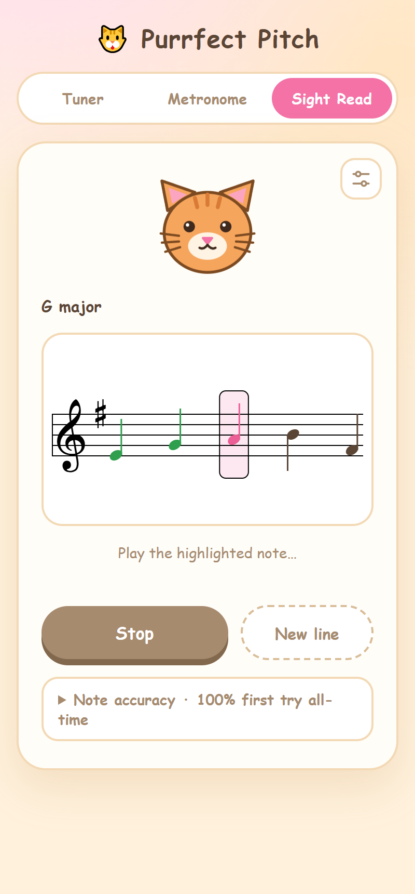

# Tuner, Metronome & Sight Reading

**[▶ Live demo](https://pinardy.github.io/purrfect-pitch/)**

<p align="center">
  
</p>

An installable PWA (React + TypeScript + Vite) with three tools you can toggle between:

- **Tuner** — chromatic tuner using the microphone and autocorrelation pitch
  detection. The A4 reference pitch is adjustable (400–480 Hz, e.g. 442 Hz)
  via the settings sheet and is persisted across sessions.
- **Metronome** — Web Audio lookahead scheduler for drift-free clicks, with
  tempo control (30–240 BPM via slider, nudge buttons, and tap tempo), beats
  per bar with an accented downbeat, and a visual beat indicator.
- **Sight Read** — random notation rendered with VexFlow in a random key
  (signature-aware, with chromatic accidentals on hard difficulty); the mic
  listens while you play and the cursor advances when you hit the right pitch.
  Correct notes turn green (orange if you missed first), wrong attempts flash
  red, and a first-try score is tallied per line. Difficulty, key mode, notes
  per line, and intonation tolerance are configurable and persisted. It
  shares the tuner's A4 reference and microphone preference. Pitch detection
  is monophonic — play single notes.
  - **Intonation** — a note held more than ±10/20/30¢ off (your choice, or
    off) turns yellow and the line waits until you bend it into tune; the
    readout says whether to ease down or push up. It still counts as read
    correctly, and each line also scores how many notes were in tune. The
    all-time note stats panel has an **Intonation** view listing the notes you
    most often play out of tune, their average drift, and whether they tend
    sharp or flat, tracked per position, plus a **Fingers** view with the same
    per finger and position ("4th finger · 3rd: tends flat"). A cents strip
    under the staff shows each note of the line as a dot raised when sharp and
    lowered when flat, the line summary names the drift ("drifting sharp as
    the line goes on"), **♪ Hear it** sounds the target note, and a settle
    time (0.3 s or 0.6 s) can require a note to stay in tune before it
    registers. An optional cue (blip and/or vibration) confirms each note.
  - **Practice history** — day-by-day first-try, in-tune and shift rates,
    filterable by position, as a chart or table; all stats export to CSV via
    the share sheet or a download.
  - **Flow and layout** — lines auto-advance after a moment or pause until
    tapped; presets (Position intro, Shifting drill, Intonation tightener,
    Test yourself) set several options at once; settings are grouped in
    collapsible sections; and in landscape on a tablet or a phone on a stand
    the staff sits beside the fingerboard so nothing scrolls while playing.
  - **Violin positions** — pick 1st to 7th position (or a random odd/any
    position per line) and every line stays within that hand frame, so you
    can drill reading in a position. Strings follow the difficulty (D and A
    on easy, all four otherwise) or a single string you choose to drill.
    Fingerings (finger above, string I–IV below where it changes) can be
    shown always, only after you tap the staff, only after a slip, or never;
    open strings can be fingered 0. A fingerboard diagram under the staff
    shows the hand frame with the current note marked, a ruler above it
    marking where every position's first finger lands, and a faint outline of
    the 1st-position home frame whenever the hand is higher, so you can see
    how far the current position sits from home.
  - **Shifting** — "Practise the shift" moves each line between a chosen
    origin position (1st by default) and the target, with one to three
    shifts a line, always ending in the target. Each shift note gets a dash
    before its finger, an optional small grey guide note shows where the old
    finger slides to, and shift notes are scored separately ("1/2 shifts
    clean") on the line, in the session, and in the history.
  - **Focus on weak notes** — weights the random notes toward the ones you
    misread, play out of tune, or have rarely seen, per position.

## Development

```sh
npm install
npm run dev
```

## Production build

```sh
npm run build
npm run preview
```

## Deploy to GitHub Pages

Deployment is automatic: every push to `main` triggers the
`.github/workflows/deploy.yml` workflow, which builds the app and publishes it
straight to GitHub Pages (no `gh-pages` branch). The site is served at
https://pinardy.github.io/purrfect-pitch/. The workflow can also be run
manually from the Actions tab via **Run workflow**.

The service worker and manifest are generated by `vite-plugin-pwa` during the
build. Note that microphone access (and PWA installation) requires a secure
context: `localhost` in development or HTTPS in production.

`npm run icons` regenerates the PNG icons in `public/` from
`scripts/generate-icons.mjs`.
